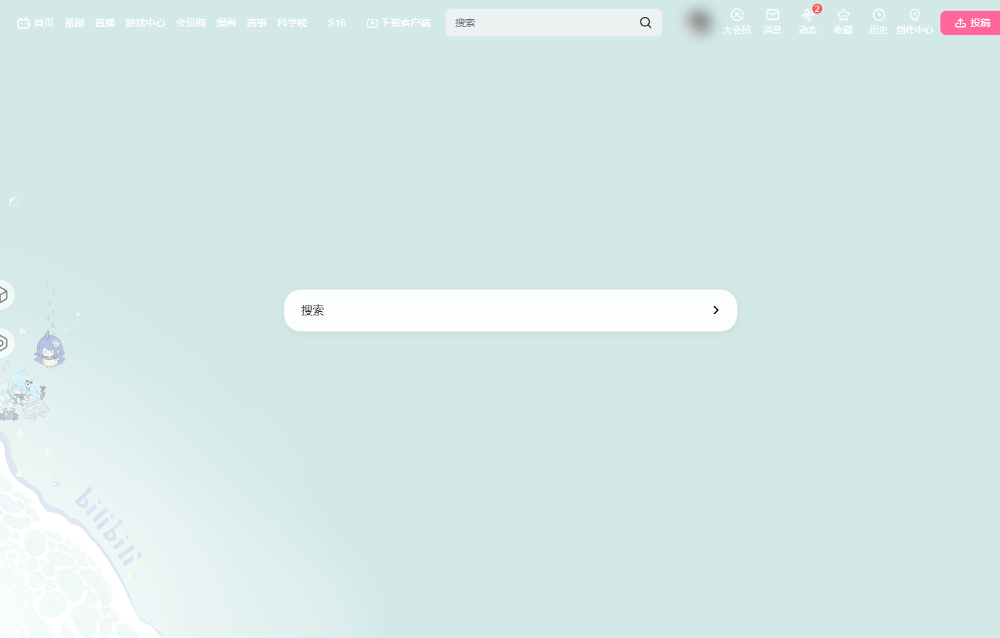
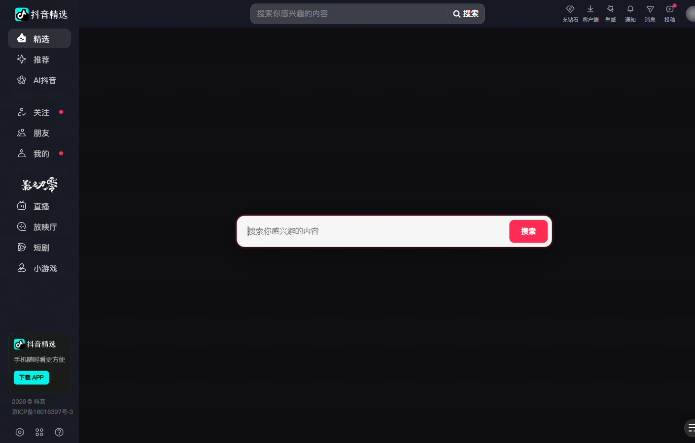
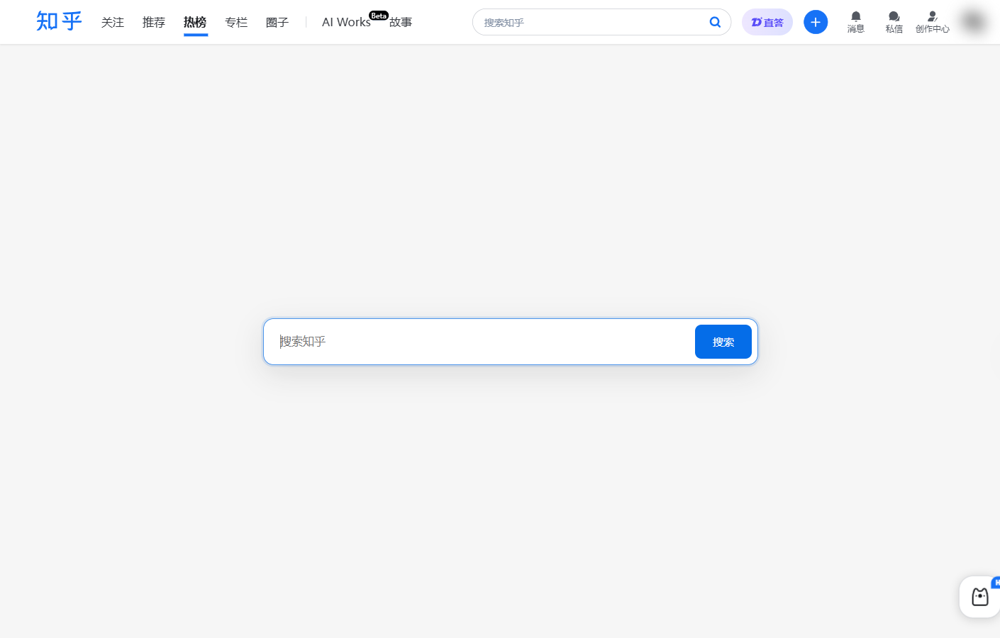
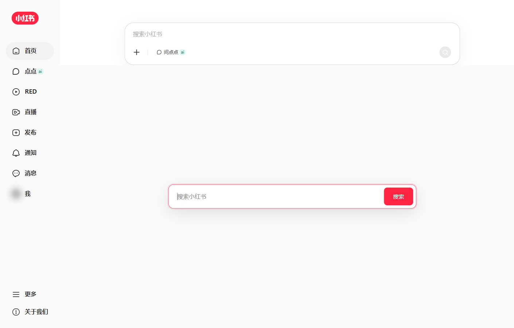

<picture>
  <source media="(prefers-color-scheme: dark)" srcset="./assets/readme/hero-dark.svg">
  
</picture>

# SMOS

**Social Media Only Search** · 隐藏社交媒体首页的推荐流，保留导航与搜索。提供油猴脚本和 Chrome / Edge 扩展两种安装方式。

[页面预览 / Preview](#页面预览--preview) · [安装 / Install](#安装--install) · [支持范围 / Support](#支持范围--support) · [开发 / Development](#开发--development)

## 页面预览 / Preview

以下为已有的扩展实测截图，并非示意图。点击查看原图；网站本身的导航可能随更新变化。

<table>
  <tr>
    <td width="50%"><b>Bilibili · 首页</b><br><a href="./assets/readme/preview-bilibili.png"></a></td>
    <td width="50%"><b>抖音 · 精选</b><br><a href="./assets/readme/preview-douyin.png"></a></td>
  </tr>
  <tr>
    <td width="50%"><b>知乎 · 热榜</b><br><a href="./assets/readme/preview-zhihu.png"></a></td>
    <td width="50%"><b>小红书 · 探索</b><br><a href="./assets/readme/preview-xiaohongshu.png"></a></td>
  </tr>
</table>

## 安装 / Install

选择一种方式即可。**不要在同一网站同时启用 SMOS 扩展和油猴脚本**，以免重复注入。

### 油猴脚本

1. 安装 [Tampermonkey](https://www.tampermonkey.net/) 或 [Violentmonkey](https://violentmonkey.github.io/)。
2. 打开 **[安装 SMOS 总脚本](https://raw.githubusercontent.com/mintonight/smos/main/smos.user.js)**，在脚本管理器中确认安装。
3. 访问下方支持的页面。总脚本会按当前网站启用对应功能；平台开关在脚本管理器的菜单中。

Raw 链接不可用时，可用 [jsDelivr 镜像](https://cdn.jsdelivr.net/gh/mintonight/smos/smos.user.js)（更新可能有缓存延迟）。

### Chrome / Edge 扩展

1. 打开 **[最新发布 / Latest release](https://github.com/mintonight/smos/releases/latest)**，下载 Assets 中的 `smos-extension-*.zip` 并解压。
2. 打开 `chrome://extensions`（Edge 为 `edge://extensions`），开启「开发者模式」。
3. 点击「加载已解压的扩展程序」，选择解压后的目录。点击工具栏的 SMOS 图标设置平台开关。

普通安装建议使用 ZIP；Chrome 对直接安装 CRX 有限制。扩展暂未适配 Firefox。参见 [完整扩展说明](./extension/README.md)。

<details>
<summary>只需要一个平台？安装独立脚本</summary>

同样需要先安装脚本管理器。不要和总脚本同时启用。

| 平台 | 安装 | 备用镜像 | 说明 |
| --- | --- | --- | --- |
| Bilibili | [Raw](https://raw.githubusercontent.com/mintonight/smos/main/smos-bilibili/smos-bilibili.user.js) | [jsDelivr](https://cdn.jsdelivr.net/gh/mintonight/smos/smos-bilibili/smos-bilibili.user.js) | [平台说明](./smos-bilibili) |
| 抖音 / Douyin | [Raw](https://raw.githubusercontent.com/mintonight/smos/main/smos-douyin/smos-douyin.user.js) | [jsDelivr](https://cdn.jsdelivr.net/gh/mintonight/smos/smos-douyin/smos-douyin.user.js) | [平台说明](./smos-douyin) |
| 知乎 / Zhihu | [Raw](https://raw.githubusercontent.com/mintonight/smos/main/smos-zhihu/smos-zhihu.user.js) | [jsDelivr](https://cdn.jsdelivr.net/gh/mintonight/smos/smos-zhihu/smos-zhihu.user.js) | [平台说明](./smos-zhihu) |
| 小红书 / Xiaohongshu | [Raw](https://raw.githubusercontent.com/mintonight/smos/main/smos-xiaohongshu/smos-xiaohongshu.user.js) | [jsDelivr](https://cdn.jsdelivr.net/gh/mintonight/smos/smos-xiaohongshu/smos-xiaohongshu.user.js) | [平台说明](./smos-xiaohongshu) |
| X（Twitter） | [Raw](https://raw.githubusercontent.com/mintonight/smos/main/smos-x/smos-x.user.js) | [jsDelivr](https://cdn.jsdelivr.net/gh/mintonight/smos/smos-x/smos-x.user.js) | [平台说明](./smos-x) |
| YouTube | [Raw](https://raw.githubusercontent.com/mintonight/smos/main/smos-youtube/smos-youtube.user.js) | [jsDelivr](https://cdn.jsdelivr.net/gh/mintonight/smos/smos-youtube/smos-youtube.user.js) | [平台说明](./smos-youtube) |

</details>

## 支持范围 / Support

| 平台 | 生效页面 | 页面变化 |
| --- | --- | --- |
| Bilibili | 首页 `/`、`/index.html`；视频、番剧等播放页¹ | 首页仅搜索；播放页可隐藏相关推荐、设置播放器模式 |
| 抖音 / Douyin | 精选 `/jingxuan` 及其子路径；推荐首页 `/?recommend=*` | 隐藏内容流、保留搜索；目标页暂停并静音音视频 |
| 知乎 / Zhihu | 首页 `/`、发现 `/explore`、热榜 `/hot` | 保留导航，内容区替换为搜索框 |
| 小红书 / Xiaohongshu | 首页 `/`、探索 `/explore` | 保留导航，内容区替换为搜索框 |
| X（Twitter） | 首页 `/`、主页时间线 `/home` | 保留左侧导航，隐藏时间线与右侧栏，内容区替换为搜索框 |
| YouTube | 首页 `/` | 保留顶部导航与左侧栏，隐藏推荐网格，内容区替换为搜索框 |

¹ Bilibili 播放页覆盖 `/video/*`、`/bangumi/play/*`、`/list/*`、`/medialist/play/*`、`/cheese/*`、`/festival/*`。

- 搜索仍使用平台原生结果页，不替换搜索结果。
- 抖音、知乎、小红书离开目标路由后移除搜索界面，返回时恢复；抖音的媒体限制也只在目标页生效。
- 抖音、小红书、X、YouTube 适配亮色 / 深色主题；知乎使用浅色界面。
- Bilibili 与抖音的自定义背景设置仅在油猴版提供，扩展版暂不支持。

## 开发 / Development

平台逻辑维护在 `smos-*/smos-*.user.js`，总脚本与扩展内容脚本由工具生成。修改后运行：

```bash
npm ci            # 首次：安装开发工具；产物本身没有运行时依赖
npm run build     # 生成 smos.user.js 的平台代码段和 extension/content/
npm run verify    # 同步、语法、版本、lint、测试与 jsdom 运行时验证
```

[贡献与开发约定](./Agent.md) · [扩展构建与发布](./extension/README.md#构建-crx--zip) · [反馈问题](https://github.com/mintonight/smos/issues)

## License

[MIT](./LICENSE)
