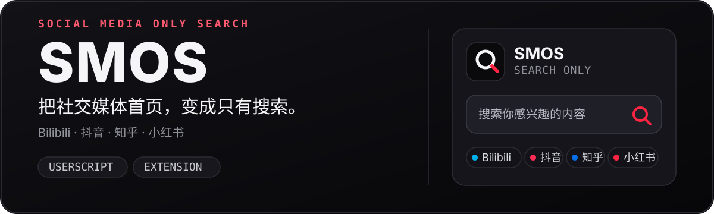
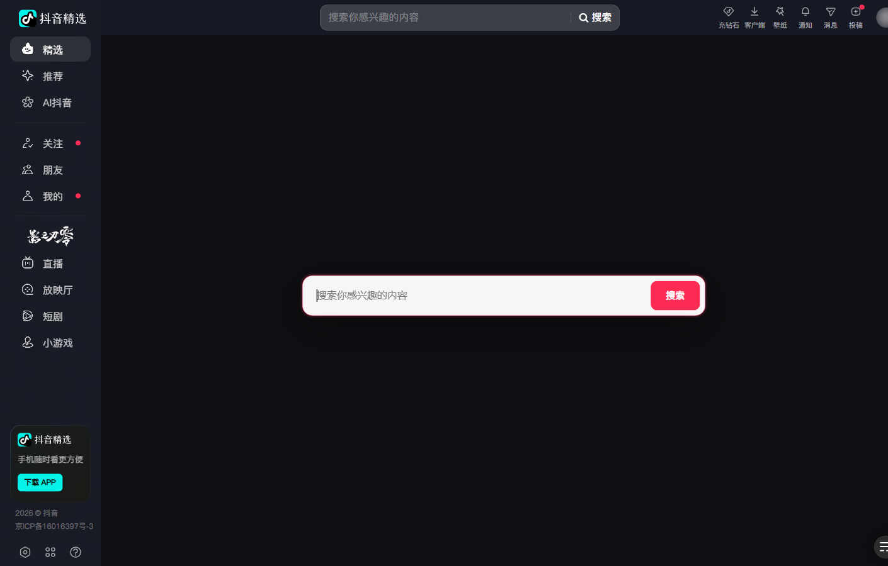
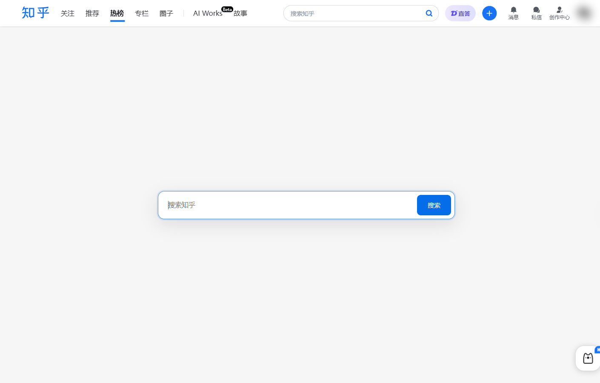
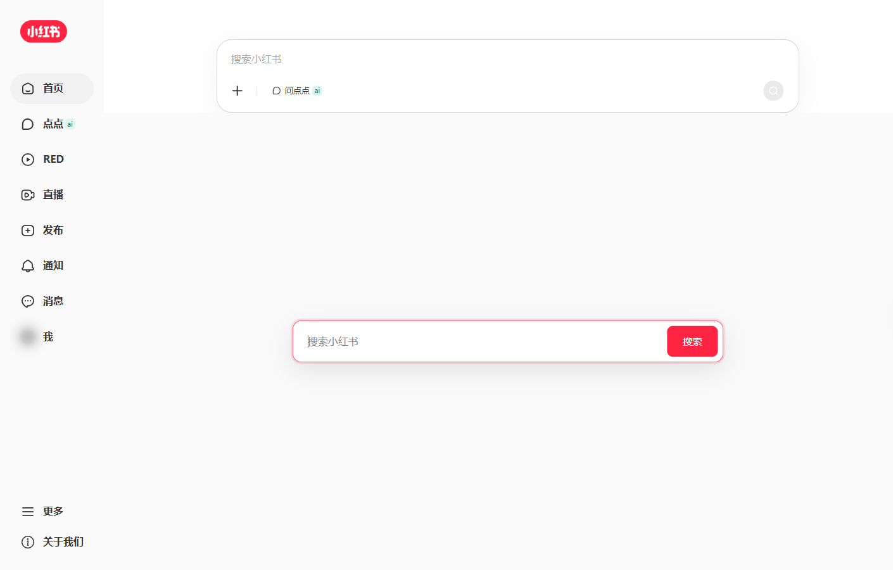

<p align="center">
  
</p>

# SMOS   

SMOS（Social Media Only Search）把社交媒体首页变成“仅搜索”界面，提供油猴脚本和 Manifest V3 浏览器扩展两种安装方式。

## Preview

以下截图来自加载 SMOS 扩展后的实际页面，点击图片可查看大图。

<table width="100%">
  <tr>
    <td align="center" width="50%">
      <a href="./assets/readme/preview-bilibili.png"></a>
      <br>
      <sub><b>Bilibili</b></sub>
    </td>
    <td align="center" width="50%">
      <a href="./assets/readme/preview-douyin.png"></a>
      <br>
      <sub><b>抖音</b></sub>
    </td>
  </tr>
  <tr>
    <td align="center" width="50%">
      <a href="./assets/readme/preview-zhihu.png"></a>
      <br>
      <sub><b>知乎</b></sub>
    </td>
    <td align="center" width="50%">
      <a href="./assets/readme/preview-xiaohongshu.png"></a>
      <br>
      <sub><b>小红书</b></sub>
    </td>
  </tr>
</table>

## 总脚本

推荐直接安装总脚本，它会根据当前网站自动启用对应平台功能：

- [GitHub Raw 安装](https://raw.githubusercontent.com/mintonight/smos/main/smos.user.js)
- [jsDelivr 安装](https://cdn.jsdelivr.net/gh/mintonight/smos/smos.user.js)

## 浏览器扩展

仓库中的 [`extension/`](./extension) 是 Manifest V3 扩展版本，可在 Chrome/Edge 中通过“加载已解压的扩展程序”安装。每次 push / PR 都会跑校验（`verify.yml`）；推送 `v*` tag（需与 `manifest.json` 版本一致）时自动构建 CRX/ZIP 并发布 GitHub Release（`release.yml`）。

- 安装与开发说明：[`extension/README.md`](./extension/README.md)
- 发布产物：GitHub Releases 中的 `.crx` 和 `.zip`

## 平台目录

| 平台 | 支持页面 | 脚本 |
| --- | --- | --- |
| Bilibili | `/`、视频/番剧等内容页 | [`smos-bilibili`](./smos-bilibili) |
| Douyin | `/jingxuan`、`/?recommend=*` | [`smos-douyin`](./smos-douyin) |
| Zhihu | `/`、`/explore`、`/hot` | [`smos-zhihu`](./smos-zhihu) |
| Xiaohongshu | `/`、`/explore` | [`smos-xiaohongshu`](./smos-xiaohongshu) |

## 安装单个平台（可选）

先安装 [Tampermonkey](https://www.tampermonkey.net/) 或 Violentmonkey，再选择对应平台目录中的脚本：

- Bilibili：[Raw](https://raw.githubusercontent.com/mintonight/smos/main/smos-bilibili/smos-bilibili.user.js) · [jsDelivr](https://cdn.jsdelivr.net/gh/mintonight/smos/smos-bilibili/smos-bilibili.user.js)
- Douyin：[Raw](https://raw.githubusercontent.com/mintonight/smos/main/smos-douyin/smos-douyin.user.js) · [jsDelivr](https://cdn.jsdelivr.net/gh/mintonight/smos/smos-douyin/smos-douyin.user.js)
- Zhihu：[Raw](https://raw.githubusercontent.com/mintonight/smos/main/smos-zhihu/smos-zhihu.user.js) · [jsDelivr](https://cdn.jsdelivr.net/gh/mintonight/smos/smos-zhihu/smos-zhihu.user.js)
- Xiaohongshu：[Raw](https://raw.githubusercontent.com/mintonight/smos/main/smos-xiaohongshu/smos-xiaohongshu.user.js) · [jsDelivr](https://cdn.jsdelivr.net/gh/mintonight/smos/smos-xiaohongshu/smos-xiaohongshu.user.js)

## 功能

- 保留平台原生顶栏、侧栏和导航。
- 隐藏首页推荐流，只显示可聚焦的中央搜索框。
- 使用平台原生搜索结果页，不处理详情页。
- Bilibili 保留播放器模式、背景设置等原有功能。
- 油猴菜单中可分别开关 Bilibili、抖音、知乎和小红书脚本。
- 在平台内进入专栏、关注、通知等非目标模块时自动移除搜索框，返回首页、热榜、精选等页面时自动恢复。
- 抖音、小红书搜索框适配亮色和深色模式。

## 目录

每个平台目录都包含独立的油猴脚本、README 和 MIT License；扩展版本位于 `extension/`，平台内容脚本由油猴脚本生成。

## 开发校验

修改脚本后运行：

```bash
node tools/verify-userscripts.mjs
```

该脚本会检查各脚本语法、UserScript 元数据，以及 `smos.user.js` 与四个分平台脚本的代码段是否同步。

扩展版本校验：

```bash
node tools/verify-extension.mjs
```

## License

MIT
